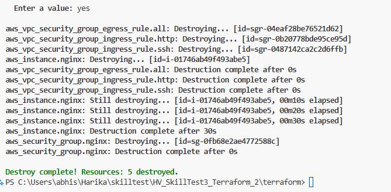

# Terraform-managed Nginx on AWS

This Terraform configuration launches a public Ubuntu 20.04 LTS `t3.micro` EC2
instance in the AWS **default VPC**. It does not create a VPC, subnet, or
internet gateway. The instance security group allows inbound HTTP on port 80,
SSH on port 22, and outbound traffic required to install Nginx. EC2 user data
installs Nginx and replaces its default page with:

> Welcome to the Terraform-managed Nginx Server on Ubuntu

The AWS account must have a default VPC and at least one default subnet in the
selected region. Configure AWS credentials using your normal AWS CLI/SDK
credential method before provisioning. The configured region is `ap-south-1`.

## Prerequisites

- Install Terraform CLI version 1.3.0 or later and AWS CLI v2.
- Have an AWS account with permission to use EC2 in `ap-south-1`. The identity
  needs to describe VPCs, subnets, and AMIs; launch and terminate EC2 instances;
  and create, manage, and delete security groups and their rules.
- Configure credentials for the AWS account you intend to use. For an AWS CLI
  profile, select it in the same terminal before running Terraform:

  ```powershell
  $env:AWS_PROFILE = "your-profile"
  aws sts get-caller-identity
  ```

  Confirm that the returned account ID is the intended account. Do not put
  access keys in Terraform files or commit them to the repository.
- Ensure that the account has a default VPC and at least one default subnet in
  `ap-south-1`, with a route to the internet so the instance can install Nginx.
- Check that the account can launch `t3.micro` in the selected region and has
  available EC2 capacity/quota.
- In `terraform.tfvars`, change `ssh_cidr` from `0.0.0.0/0` to your public IPv4
  address with a `/32` mask before applying.

## Provision

Run the following Terraform CLI commands from the `terraform` directory:

```text
terraform init
terraform plan
terraform apply
```
> 

> 

> 

Confirm the apply when prompted. On completion, Terraform prints `public_ip`
and `website_url`. Open the URL in a browser after the instance finishes
running its user-data script (typically a few minutes).

> 

## SSH access

The SSH ingress rule defaults to `0.0.0.0/0` to satisfy the task requirement.
Before applying, restrict `ssh_cidr` in `terraform.tfvars` to your public IPv4
address in `/32` notation. The instance does not configure an EC2 key pair, so
the SSH rule only opens network access; add a key pair separately if you need
interactive SSH login.


## Destroy

To remove the instance and security group created by this configuration, run
from the `terraform` directory:

```text
terraform destroy
```
> 

The default VPC and its existing networking resources are data sources and are
not managed or deleted by this configuration.
