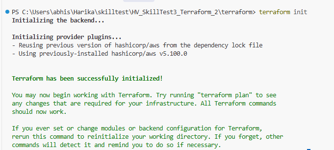
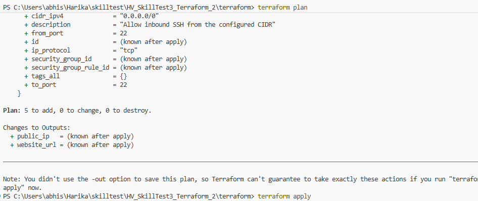
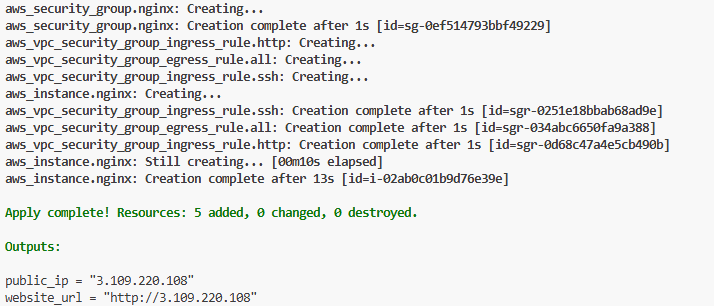
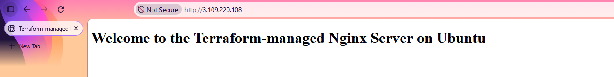

# Terraform-managed Nginx on AWS

This Terraform configuration launches a public Ubuntu 20.04 LTS `t3.micro` EC2
instance in the AWS **default VPC**. It does not create a VPC, subnet, or
internet gateway. The instance security group allows inbound HTTP on port 80,
SSH on port 22, and outbound traffic required to install Nginx. EC2 user data
installs Nginx and replaces its default page with:

> Welcome to the Terraform-managed Nginx Server on Ubuntu

The AWS account must have a default VPC and at least one default subnet in the
selected region. Configure AWS credentials using your normal AWS CLI/SDK
credential method before provisioning. The configured region is `ap-south-1`.

## Provision

Run the following Terraform CLI commands from the `terraform` directory:

```text
terraform init
terraform plan
terraform apply
```
> 

> 

> 

Confirm the apply when prompted. On completion, Terraform prints `public_ip`
and `website_url`. Open the URL in a browser after the instance finishes
running its user-data script (typically a few minutes).

> 

## SSH access

The SSH ingress rule defaults to `0.0.0.0/0` to satisfy the task requirement.
Before applying, restrict `ssh_cidr` in `terraform.tfvars` to your public IPv4
address in `/32` notation. The instance does not configure an EC2 key pair, so
the SSH rule only opens network access; add a key pair separately if you need
interactive SSH login.

## Destroy

To remove the instance and security group created by this configuration, run
from the `terraform` directory:

```text
terraform destroy
```

The default VPC and its existing networking resources are data sources and are
not managed or deleted by this configuration.
